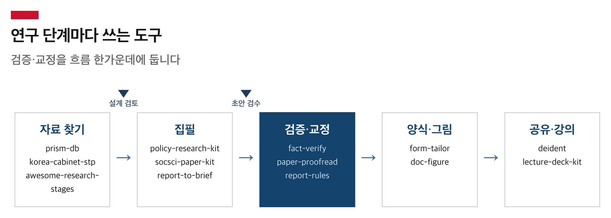

# 박주이 · Jui Park

데이터와 AI로 과학기술정책을 연구합니다. 한양대학교 과학기술정책연구소와 정책한걸음에서 활동하고 있습니다.

연구하며 만든 Claude Code 도구를 이곳에 공개합니다.



## 멀티에이전트 하네스

역할을 나눈 서브에이전트가 설계 검토와 초안 검수 게이트를 통과해야 다음 단계로 넘어가는 Claude Code 플러그인입니다.

| 저장소 | 만드는 것 |
|---|---|
| [policy-research-kit](https://github.com/parkjui92/policy-research-kit) | 정책연구보고서·정책브리프 (.hwpx) |
| [socsci-paper-kit](https://github.com/parkjui92/socsci-paper-kit) | 사회과학 논문, 심사의견 대응 (.docx) |
| rnd-proposal-kit (비공개) | 정부 R&D 제안서 초안 (.hwpx) |

## 에이전트 스킬

| 저장소 | 하는 일 |
|---|---|
| [fact-verify](https://github.com/parkjui92/fact-verify) | 출처가 진짜인지 확인, 발췌를 원문과 기계 대조 |
| [paper-proofread](https://github.com/parkjui92/paper-proofread) | 한국어 학술논문 교정교열 |
| [report-rules](https://github.com/parkjui92/report-rules) | 보고서 작성 규칙과 초안 점검기 |
| [report-to-brief](https://github.com/parkjui92/report-to-brief) | 긴 보고서를 1~8쪽 브리프로 압축 |
| [form-tailor](https://github.com/parkjui92/form-tailor) | 기관 양식 샘플대로 새 문서 작성 |
| [doc-figure](https://github.com/parkjui92/doc-figure) | 문서용 삽도, 한글이 깨지지 않는 코드 렌더 |
| [lecture-deck-kit](https://github.com/parkjui92/lecture-deck-kit) | HTML 강의자료, 브라우저에서 드래그해 바로 수정 |

## 도구와 데이터

| 저장소 | 하는 일 |
|---|---|
| [deident](https://github.com/parkjui92/deident) | 문서 민감정보 비식별화, 전 과정 로컬 |
| [prism-db](https://github.com/parkjui92/prism-db) | 정책연구용역(PRISM) 로컬 검색 CLI |
| [korea-cabinet-stp](https://github.com/parkjui92/korea-cabinet-stp) | 국무회의 안건 아카이브 (2018~2026) |
| [awesome-research-stages](https://github.com/parkjui92/awesome-research-stages) | 연구 단계별 오픈소스 도구 목록 |

## 실측으로 확인한 것

- 같은 주제를 일반 Claude Code와 policy-research-kit에 각각 맡기고, 양쪽이 인용한 링크(일반 10개, 플러그인 4개)를 전부 열어 원문과 대조했습니다. 수치·귀속 오류는 일반 쪽 2건(연도 혼입 1건 별도), 플러그인 쪽 0건이었습니다. → [비교 실험 기록](https://github.com/parkjui92/policy-research-kit/blob/main/docs/vanilla-vs-kit.md)
- fact-verify는 실제로 돌린 검증 보고서 65건을 다시 읽어 판정 규칙을 고쳤습니다. 가장 많던 오류는 지어낸 문헌이 아니라 맞는 출처에 붙은 틀린 꼬리표였습니다. → [변경 기록](https://github.com/parkjui92/fact-verify/blob/main/CHANGELOG.md)
- prism-db는 정책연구용역 74,129건을 모읍니다. 연도별로 나눠 받으면 26%가 조용히 빠진다는 것을 실측으로 찾아 수집 방식을 바꿨습니다. → [README](https://github.com/parkjui92/prism-db#readme)
- korea-cabinet-stp는 2018년 9월부터 2026년 7월까지 국무회의 447회, 안건 16,742건을 공식 의사일정 원문에서 추출했습니다. → [README](https://github.com/parkjui92/korea-cabinet-stp#readme)

## 처음이라면

가장 가벼운 것은 paper-proofread입니다.

```bash
mkdir -p ~/.claude/skills && cd ~/.claude/skills && git clone https://github.com/parkjui92/paper-proofread.git
```

Claude Code를 다시 켜고 "이 문단 교정해줘"라고 하면 됩니다. 막힌 곳이 있으면 그 저장소의 Issues에 남겨 주세요.

## 알아두실 점

- 모두 초안과 점검 결과를 만드는 도구입니다. 내보내기 전 판단은 사람이 합니다.
- 코드는 대부분 MIT입니다. 수집 데이터(prism-db·korea-cabinet-stp)는 원 자료의 이용 조건(공공누리)을 따릅니다. 자세한 조건은 각 저장소의 LICENSE에 있습니다.
- 질문과 버그는 각 저장소의 Issues로 받습니다.

<details>
<summary>English</summary>

I research science & technology policy through data and AI, working with the Science and Technology Policy Institute at Hanyang University and 정책한걸음 (The Step in Public Policy). These are the Claude Code tools I built along the way.

- **Multi-agent harnesses** — [policy-research-kit](https://github.com/parkjui92/policy-research-kit) (policy reports and briefs), [socsci-paper-kit](https://github.com/parkjui92/socsci-paper-kit) (social science papers and reviewer responses). Role-split subagents must pass a design review and a draft review before moving on.
- **Agent skills** — [fact-verify](https://github.com/parkjui92/fact-verify) (source verification with a claim–evidence ledger), [paper-proofread](https://github.com/parkjui92/paper-proofread) (Korean academic proofreading), [report-rules](https://github.com/parkjui92/report-rules), [report-to-brief](https://github.com/parkjui92/report-to-brief), [form-tailor](https://github.com/parkjui92/form-tailor), [doc-figure](https://github.com/parkjui92/doc-figure), [lecture-deck-kit](https://github.com/parkjui92/lecture-deck-kit)
- **CLI and data** — [deident](https://github.com/parkjui92/deident) (local de-identification of Korean documents), [prism-db](https://github.com/parkjui92/prism-db), [korea-cabinet-stp](https://github.com/parkjui92/korea-cabinet-stp), [awesome-research-stages](https://github.com/parkjui92/awesome-research-stages)

Questions and bug reports go to each repository's Issues.

</details>

## 연락

parkjui92@gmail.com
